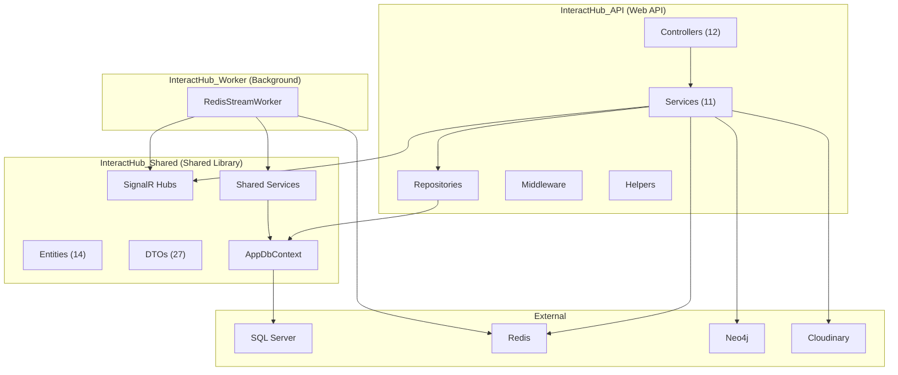
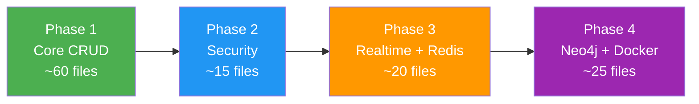

# 🚀 InteractHub Backend Migration Plan: .NET → Spring Boot

## Mục tiêu

Chuyển đổi toàn bộ backend dự án mạng xã hội **InteractHub** từ **ASP.NET Core** sang **Java Spring Boot 3.x**, giữ nguyên vẹn logic nghiệp vụ, real-time communication, cơ sở dữ liệu quan hệ, đồ thị và caching.

---

## 📊 Phân tích Source Code Hiện tại

### Kiến trúc tổng quan (.NET)



### Thống kê codebase

| Thành phần | Số lượng | Chi tiết |
|:---|:---:|:---|
| **Entities** | 14 | ApplicationUser, Post, Comment, Like, Conversation, Friendship, Message, Notification, Hashtag, PostHashtag, PostMedia, PostReport, Story, MediaType(enum) |
| **DTOs** | 27+ | Auth(3), Chat(4), Friends(1), Interactions(5), Media(1), Moderation(2), Notifications(1), Posts(8), Profiles(3), Stories(2) |
| **Controllers** | 12 | Auth, Comments, Post, Friends, Interaction, AdminModeration, Notification, Profile, Story, Chat, Hashtag, Friendship |
| **Services** | 11+interfaces | Auth, Chat, Comment, Interaction, Post, Profile, Report, Story, StoryCleanup, Friend, Hashtag, CloudinaryService, AdvancedGraphService, NotificationService, PresenceService |
| **Hubs (SignalR)** | 1 | NotificationHub (chat, typing, notifications, presence) |
| **Worker** | 1 | RedisStreamWorker (consumer group) |

---

## 🔄 Tech Stack Mapping

| .NET Component | Spring Boot Equivalent | Ghi chú |
|:---|:---|:---|
| ASP.NET Core Web API | **Spring Boot 3.x + Spring Web** | REST controllers |
| Entity Framework Core | **Spring Data JPA + Hibernate** | ORM |
| SQL Server | **PostgreSQL** | Mạnh hơn cho social features |
| ASP.NET Core Identity | **Spring Security + custom UserDetails** | Auth/user management |
| JWT (System.IdentityModel) | **jjwt (io.jsonwebtoken)** | Token generation |
| SignalR Hubs | **Spring WebSocket + STOMP** | Real-time |
| StackExchange.Redis | **Spring Data Redis (Lettuce)** | Caching + Pub/Sub + Streams |
| Neo4j.Driver | **Spring Data Neo4j** | Graph DB |
| CloudinaryDotNet | **Cloudinary Java SDK** | Media upload |
| Fluent Validation / Data Annotations | **jakarta.validation (Bean Validation)** | Input validation |
| Lombok | **Lombok** | Reduce boilerplate |
| BackgroundService | **@Scheduled / Spring Kafka Consumer** | Background tasks |
| Middleware (RateLimiting) | **Spring Filter / Bucket4j** | Rate limiting |

---

## ⚠️ Quyết định Cần Xác Nhận

> [!NOTE]
> ✅ Tất cả quyết định đã được xác nhận bởi User.

| # | Câu hỏi | ✅ Quyết định | Ghi chú |
|:---:|:---|:---|:---|
| 1 | **Build tool** | **Gradle (Kotlin DSL)** | Cú pháp gọn, build nhanh, phổ biến với Spring Boot 3.x |
| 2 | **Database** | **PostgreSQL** | Full-text search, JSON, array types — phù hợp social network |
| 3 | **Java version** | **Java 21 (LTS)** | Virtual threads hỗ trợ tốt cho concurrent WebSocket connections |
| 4 | **Naming convention** | **Tiếng Anh** | Best practice, tránh encoding issues, dễ maintain |
| 5 | **Worker service** | **Tích hợp vào main app** | Dùng `@Async` + `@EventListener` + `StreamListener`. Tách ra sau nếu cần scale |
| 6 | **Password hashing** | **BCrypt** | Spring Security default. User cũ cần reset password khi migrate |

---

## 📁 Cấu trúc Project Spring Boot

```
interacthub-backend/
├── build.gradle.kts
├── settings.gradle.kts
├── docker-compose.yml
├── Dockerfile
├── src/
│   ├── main/
│   │   ├── java/com/interacthub/
│   │   │   ├── InteractHubApplication.java
│   │   │   ├── config/
│   │   │   │   ├── SecurityConfig.java
│   │   │   │   ├── WebSocketConfig.java
│   │   │   │   ├── RedisConfig.java
│   │   │   │   ├── Neo4jConfig.java
│   │   │   │   ├── CloudinaryConfig.java
│   │   │   │   └── CorsConfig.java
│   │   │   ├── security/
│   │   │   │   ├── JwtTokenProvider.java
│   │   │   │   ├── JwtAuthenticationFilter.java
│   │   │   │   ├── CustomUserDetails.java
│   │   │   │   └── CustomUserDetailsService.java
│   │   │   ├── entity/
│   │   │   │   ├── User.java
│   │   │   │   ├── Post.java
│   │   │   │   ├── Comment.java
│   │   │   │   ├── Like.java
│   │   │   │   ├── LikeId.java (EmbeddedId)
│   │   │   │   ├── Conversation.java
│   │   │   │   ├── Friendship.java
│   │   │   │   ├── FriendshipId.java (EmbeddedId)
│   │   │   │   ├── Message.java
│   │   │   │   ├── Notification.java
│   │   │   │   ├── Hashtag.java
│   │   │   │   ├── PostHashtag.java
│   │   │   │   ├── PostHashtagId.java (EmbeddedId)
│   │   │   │   ├── PostMedia.java
│   │   │   │   ├── PostReport.java
│   │   │   │   ├── Story.java
│   │   │   │   └── enums/
│   │   │   │       ├── MediaType.java
│   │   │   │       ├── FriendshipStatus.java
│   │   │   │       └── NotificationType.java
│   │   │   ├── repository/
│   │   │   │   ├── UserRepository.java
│   │   │   │   ├── PostRepository.java
│   │   │   │   ├── CommentRepository.java
│   │   │   │   ├── LikeRepository.java
│   │   │   │   ├── ConversationRepository.java
│   │   │   │   ├── FriendshipRepository.java
│   │   │   │   ├── MessageRepository.java
│   │   │   │   ├── NotificationRepository.java
│   │   │   │   ├── HashtagRepository.java
│   │   │   │   ├── PostHashtagRepository.java
│   │   │   │   ├── PostMediaRepository.java
│   │   │   │   ├── PostReportRepository.java
│   │   │   │   └── StoryRepository.java
│   │   │   ├── dto/
│   │   │   │   ├── auth/
│   │   │   │   ├── chat/
│   │   │   │   ├── comment/
│   │   │   │   ├── friend/
│   │   │   │   ├── interaction/
│   │   │   │   ├── media/
│   │   │   │   ├── moderation/
│   │   │   │   ├── notification/
│   │   │   │   ├── post/
│   │   │   │   ├── profile/
│   │   │   │   └── story/
│   │   │   ├── service/
│   │   │   │   ├── AuthService.java
│   │   │   │   ├── ChatService.java
│   │   │   │   ├── CommentService.java
│   │   │   │   ├── FeedService.java
│   │   │   │   ├── FriendService.java
│   │   │   │   ├── HashtagService.java
│   │   │   │   ├── InteractionService.java
│   │   │   │   ├── NotificationService.java
│   │   │   │   ├── PostService.java
│   │   │   │   ├── PresenceService.java
│   │   │   │   ├── ProfileService.java
│   │   │   │   ├── ReportService.java
│   │   │   │   ├── StoryService.java
│   │   │   │   ├── StoryCleanupService.java
│   │   │   │   ├── CloudinaryService.java
│   │   │   │   └── GraphService.java
│   │   │   ├── controller/
│   │   │   │   ├── AuthController.java
│   │   │   │   ├── ChatController.java
│   │   │   │   ├── CommentController.java
│   │   │   │   ├── FriendController.java
│   │   │   │   ├── HashtagController.java
│   │   │   │   ├── InteractionController.java
│   │   │   │   ├── ModerationController.java
│   │   │   │   ├── NotificationController.java
│   │   │   │   ├── PostController.java
│   │   │   │   ├── ProfileController.java
│   │   │   │   └── StoryController.java
│   │   │   ├── websocket/
│   │   │   │   ├── NotificationWebSocketHandler.java
│   │   │   │   └── ChatWebSocketHandler.java
│   │   │   ├── exception/
│   │   │   │   ├── GlobalExceptionHandler.java
│   │   │   │   ├── ResourceNotFoundException.java
│   │   │   │   ├── UnauthorizedException.java
│   │   │   │   └── BadRequestException.java
│   │   │   └── filter/
│   │   │       └── RateLimitingFilter.java
│   │   └── resources/
│   │       ├── application.yml
│   │       ├── application-dev.yml
│   │       └── application-prod.yml
│   └── test/
│       └── java/com/interacthub/
│           ├── service/
│           └── controller/
```

---

## 📋 Chi tiết Triển khai Từng Phase

---

### Phase 1: Core Foundation & Basic CRUD

> **Mục tiêu**: Khung project, kết nối PostgreSQL, Entity CRUD cơ bản
> **Ước lượng**: ~60 files, bao gồm entities, repositories, services, controllers, DTOs, config

#### 1.1 Khởi tạo Project

- [x] Tạo Spring Boot 3.x project với Gradle Kotlin DSL & Maven (`build.gradle.kts`, `pom.xml`)
- [x] Dependencies: `spring-boot-starter-web`, `spring-boot-starter-data-jpa`, `spring-boot-starter-validation`, `postgresql`, `lombok`, `jjwt`, `cloudinary`
- [x] Cấu hình `application.yml` với PostgreSQL connection
- [x] Cấu hình `application-dev.yml` cho môi trường dev

#### 1.2 Entity Migration

Chuyển đổi 14 entities từ EF Core sang JPA/Hibernate:

| C# Entity | Java Entity | Điểm khác biệt quan trọng |
|:---|:---|:---|
| `ApplicationUser` (extends IdentityUser) | `User` (standalone entity) | Không dùng Spring Security's UserDetails entity. Tự quản lý password hash, roles qua `@ManyToMany` |
| `Post` (self-ref FK) | `Post` | `@ManyToOne` self-ref cho Repost. `@OneToMany(mappedBy)` cho Reposts, Comments, Likes, PostMedias, PostHashtags |
| `Comment` (self-ref FK) | `Comment` | `@ManyToOne` self-ref cho Reply. 1-level nesting enforced in service |
| `Like` (Composite PK) | `Like` + `LikeId` | `@EmbeddedId` thay cho Composite PK. `@MapsId` cho relationships |
| `Friendship` (Composite PK) | `Friendship` + `FriendshipId` | `@EmbeddedId`. Status dùng `@Enumerated(STRING)` thay vì string |
| `PostHashtag` (Composite PK) | `PostHashtag` + `PostHashtagId` | `@EmbeddedId` join table |
| `Conversation` (User1 < User2) | `Conversation` | Unique constraint `@Table(uniqueConstraints)`, ID ordering in service |
| `Message` | `Message` | Cursor-based pagination index |
| `Notification` | `Notification` | Type dùng `@Enumerated(STRING)` |
| `Hashtag` | `Hashtag` | Unique index on content |
| `PostMedia` | `PostMedia` | `@Enumerated(STRING)` cho MediaType |
| `PostReport` | `PostReport` | `@OnDelete` cho cascade rules |
| `Story` | `Story` | 24h TTL computed field |
| `MediaType` (enum) | `MediaType` (enum) | Java enum |

**Ví dụ chuyển đổi Entity — Post:**

````carousel
```csharp
// C# (.NET) — Post.cs
public class Post
{
    public string IdPost { get; set; } = Guid.NewGuid().ToString();
    public string NoiDung { get; set; } = string.Empty;
    public DateTime CreatedAt { get; set; } = DateTime.UtcNow;
    public string IdTaiKhoan { get; set; } = string.Empty;
    public ApplicationUser TaiKhoan { get; set; } = null!;
    public string? ParentPostId { get; set; }
    public Post? ParentPost { get; set; }
    public ICollection<Post> Reposts { get; set; } = [];
    public ICollection<PostMedia> PostMedias { get; set; } = [];
    public ICollection<PostHashtag> PostHashtags { get; set; } = [];
    public ICollection<Comment> Comments { get; set; } = [];
    public ICollection<Like> Likes { get; set; } = [];
}
```
<!-- slide -->
```java
// Java (Spring Boot) — Post.java
@Entity
@Table(name = "posts")
@Getter @Setter @NoArgsConstructor
public class Post {

    @Id
    @Column(length = 36)
    private String id = UUID.randomUUID().toString();

    @Column(nullable = false, columnDefinition = "TEXT")
    private String content = "";

    @Column(nullable = false)
    private LocalDateTime createdAt = LocalDateTime.now(ZoneOffset.UTC);

    @ManyToOne(fetch = FetchType.LAZY)
    @JoinColumn(name = "user_id", nullable = false)
    private User user;

    @ManyToOne(fetch = FetchType.LAZY)
    @JoinColumn(name = "parent_post_id")
    private Post parentPost;

    @OneToMany(mappedBy = "parentPost")
    private List<Post> reposts = new ArrayList<>();

    @OneToMany(mappedBy = "post", cascade = CascadeType.ALL, orphanRemoval = true)
    private List<PostMedia> postMedias = new ArrayList<>();

    @OneToMany(mappedBy = "post", cascade = CascadeType.ALL)
    private List<PostHashtag> postHashtags = new ArrayList<>();

    @OneToMany(mappedBy = "post", cascade = CascadeType.ALL)
    private List<Comment> comments = new ArrayList<>();

    @OneToMany(mappedBy = "post", cascade = CascadeType.ALL)
    private List<Like> likes = new ArrayList<>();
}
```
````

> [!NOTE]
> **Điểm khác biệt lớn (C# → Java):**
> - **LINQ** → **Spring Data JPA Method Queries / `@Query` JPQL**: C# dùng `dbContext.Posts.Where(p => ...).OrderBy(...)` ↔ Java dùng `postRepository.findByCreatedAtBeforeOrderByCreatedAtDesc(cursor, pageable)` hoặc JPQL.
> - **Navigation Properties tự động load** → **`FetchType.LAZY` + `@EntityGraph`**: JPA mặc định lazy loading, cần dùng `@EntityGraph` hoặc `JOIN FETCH` trong JPQL để eager load khi cần.
> - **Composite PK qua Fluent API** → **`@EmbeddedId` + `@Embeddable`**: Java yêu cầu class riêng cho composite key.

#### 1.3 Repository Layer

Tạo JPA Repositories với các custom query methods:

```java
// PostRepository.java
public interface PostRepository extends JpaRepository<Post, String> {

    // Cursor-based feed — thay thế LINQ query
    @Query("SELECT p FROM Post p WHERE p.createdAt < :cursor " +
           "AND p.id NOT IN :blacklistedIds " +
           "ORDER BY p.createdAt DESC")
    List<Post> findFeedPosts(@Param("cursor") LocalDateTime cursor,
                             @Param("blacklistedIds") List<String> blacklistedIds,
                             Pageable pageable);

    List<Post> findByUserIdOrderByCreatedAtDesc(String userId);
}
```

#### 1.4 Service Layer (Phase 1 scope)

| Service | Endpoints | Mô tả |
|:---|:---|:---|
| `AuthService` | Register, Login | JWT generation (HmacSha256), BCrypt password hashing |
| `PostService` | Create, Delete, GetById, GetFeed, Repost | Cloudinary upload, hashtag regex extraction, cursor pagination |
| `CommentService` | Create, Reply, GetByPost | 1-level reply enforcement |
| `ProfileService` | GetProfile, Update, ChangePassword, UploadAvatar, ToggleFollow | Follow/Unfollow toggle |

#### 1.5 Controller Layer (Phase 1 scope)

| Controller | Base Route | Auth | Endpoints |
|:---|:---|:---|:---|
| `AuthController` | `/api/auth` | Public | `POST /register`, `POST /login` |
| `PostController` | `/api/post` | `@PreAuthorize` | `GET /{id}`, `POST /`, `DELETE /{id}`, `POST /{id}/repost`, `GET /feed` |
| `CommentController` | `/api/comments` | `@PreAuthorize` | `GET /post/{postId}`, `POST /`, `POST /{parentId}/reply` |
| `ProfileController` | `/api/profile` | `@PreAuthorize` | `GET /me`, `GET /{userId}`, `PUT /me`, `POST /change-password`, `POST /upload-avatar`, `POST /{userId}/follow`, `GET /{userId}/followers`, `GET /{userId}/following` |

#### 1.6 DTO Layer

Tạo **Request DTOs** với `jakarta.validation` annotations và **Response DTOs** tương ứng:

```java
// RegisterRequest.java
public record RegisterRequest(
    @NotBlank @Size(min = 3, max = 50) String username,
    @NotBlank @Email String email,
    @NotBlank @Size(min = 6) String password,
    String displayName
) {}

// AuthResponse.java
public record AuthResponse(
    String userId,
    String username,
    String email,
    String token,
    String role
) {}
```

> [!TIP]
> **Java Records** thay thế C# DTOs: Bất biến, tự động sinh `equals()`, `hashCode()`, `toString()`. Nhẹ hơn class + Lombok.

#### 1.7 Verification Plan (Phase 1)

- [x] Tạo và ánh xạ 14 Entities + 3 Enums + 3 EmbeddedId + 13 JpaRepositories
- [x] Tạo đầy đủ 30 DTOs (Records + Lombok builder)
- [x] Triển khai 14 Services (Auth, Post, Comment, Profile, Friend, Chat, Story, Interaction, Notification, Hashtag, Cloudinary, Report, Cleanup, Presence)
- [x] Triển khai 11 REST Controllers với BaseController hỗ trợ SecurityContext
- [x] Biên dịch thành công 102 source files Java 21 với Maven (`BUILD SUCCESS`)
- [x] Unit Test AuthService (4/4 tests pass với Mockito & JUnit 5)
- [ ] Khởi chạy runtime cùng PostgreSQL test kết nối & DDL auto-create tables (khi có container DB)

---

### Phase 2: Security & Authentication

> **Mục tiêu**: Bảo mật hệ thống, JWT filter chain, phân quyền ROLE_USER / ROLE_ADMIN
> **Ước lượng**: ~15 files

#### 2.1 Spring Security Configuration

- [x] `SecurityConfig.java`: Stateless session, CSRF disabled, CORS config, EntryPoint & AccessDeniedHandler
- [x] `JwtTokenProvider.java`: Generate/validate JWT tokens, remaining TTL, extract claims
- [x] `JwtAuthenticationFilter.java`: OncePerRequestFilter, extract token, kiểm tra blacklist, nạp SecurityContext
- [x] `CustomUserDetailsService.java`: Load user từ DB theo email và userId cho Spring Security context
- [x] `RefreshToken.java` & `RefreshTokenService.java`: Cấp phát, xác thực, xoay vòng (token rotation) và thu hồi refresh token
- [x] `TokenBlacklistService.java`: Quản lý danh sách đen các access token đã logout

**Mapping từ .NET:**

| ASP.NET Core | Spring Security |
|:---|:---|
| `[Authorize]` | `@PreAuthorize("isAuthenticated()")` hoặc `.authenticated()` trong SecurityFilterChain |
| `[Authorize(Roles = "Admin")]` | `@PreAuthorize("hasRole('ADMIN')")` |
| `User.FindFirst("uid")` | `SecurityContextHolder.getContext().getAuthentication().getName()` hoặc `@AuthenticationPrincipal` |
| `IdentityUser` | Custom `User` entity + `UserDetailsService` adapter |

#### 2.2 Rate Limiting

- [x] `RateLimitingFilter.java`: Port `RateLimitingMiddleware.cs` sang Spring Filter, chặn 429 kèm header `Retry-After`
- [x] `RateLimiterService.java`: Quản lý sliding/fixed window counter cho IP / userId

#### 2.3 Validation

- [x] Thêm `jakarta.validation` annotations vào tất cả Request DTOs
- [x] `GlobalExceptionHandler.java` (`@RestControllerAdvice`): Xử lý `MethodArgumentNotValidException`, `ResourceNotFoundException`, `UnauthorizedException`, `BadCredentialsException`, `JwtException`

#### 2.4 Verification Plan (Phase 2)

- [x] Test truy cập API không có token → 401 JSON chuẩn
- [x] Test truy cập Admin API bằng ROLE_USER → 403 JSON chuẩn
- [x] Test truy cập Admin API bằng ROLE_ADMIN → 200 OK thành công
- [x] Test validation: gửi email sai format, password quá ngắn → 400 kèm chi tiết lỗi từng field
- [x] Test rate limiting: gửi request vượt ngưỡng → 429 Too Many Requests kèm Retry-After header
- [x] Test refresh token & logout: thu hồi token, đưa access token vào blacklist thành công (11/11 tests PASSED)

---

### Phase 3: Real-time Communication & Caching

> **Mục tiêu**: Thay thế SignalR bằng Spring WebSocket/STOMP, tích hợp Redis
> **Ước lượng**: ~20 files

#### 3.1 Spring WebSocket + STOMP

Chuyển đổi `NotificationHub.cs` (SignalR) → Spring WebSocket:

| SignalR (.NET) | Spring WebSocket | Ghi chú |
|:---|:---|:---|
| `Hub<INotificationClient>` | `@MessageMapping` + `SimpMessagingTemplate` | STOMP protocol |
| `Clients.User(userId).ReceiveNotification(...)` | `messagingTemplate.convertAndSendToUser(userId, "/queue/notifications", ...)` | User-targeted messages |
| `Groups.AddToGroupAsync(conversationId)` | STOMP subscription `/topic/conversation/{id}` | Group messaging |
| Hub method `SendChatMessage` | `@MessageMapping("/chat.send")` | Client→Server messages |
| Hub method `StartTyping/StopTyping` | `@MessageMapping("/chat.typing")` | Typing indicators |
| `OnConnectedAsync` / `OnDisconnectedAsync` | `SessionConnectedEvent` / `SessionDisconnectEvent` listeners | Presence tracking |

**Cấu hình:**

```java
@Configuration
@EnableWebSocketMessageBroker
public class WebSocketConfig implements WebSocketMessageBrokerConfigurer {
    @Override
    public void configureMessageBroker(MessageBrokerRegistry config) {
        // Dùng Redis message broker cho scale multi-instance
        config.enableStompBrokerRelay("/topic", "/queue")
              .setRelayHost("localhost").setRelayPort(6379);
        config.setApplicationDestinationPrefixes("/app");
        config.setUserDestinationPrefix("/user");
    }

    @Override
    public void registerStompEndpoints(StompEndpointRegistry registry) {
        registry.addEndpoint("/ws")
                .setAllowedOriginPatterns("*")
                .withSockJS(); // Fallback cho browser cũ
    }
}
```

#### 3.2 Spring Data Redis

| .NET Redis Usage | Spring Boot Equivalent |
|:---|:---|
| `IConnectionMultiplexer` (StackExchange.Redis) | `RedisTemplate<String, String>` / `StringRedisTemplate` |
| Redis Sorted Set (trending hashtags) | `redisTemplate.opsForZSet()` |
| Redis Set (`blacklisted_posts`) | `redisTemplate.opsForSet()` |
| Redis Set (`user:presence:{userId}`) | `redisTemplate.opsForSet()` + TTL |
| Redis Stream (`interacthub:notifications:stream`) | `StreamMessageListenerContainer` + `StreamListener` |
| SignalR Redis Backplane | Spring WebSocket Relay + Redis Pub/Sub |
| `IDistributedCache` | `@Cacheable` / `@CacheEvict` annotations với Redis backend |

**Services cần tích hợp Redis:**

- [x] `PresenceService`: Redis Set cho multi-device online tracking (30min TTL)
- [x] `HashtagService`: Redis Sorted Set cho trending daily/weekly/monthly
- [x] `ReportService`: Redis Set `blacklisted_posts` cho content moderation
- [x] `PostService` (feed): Đọc blacklist từ Redis khi build feed

#### 3.3 Redis Stream Worker (Thay thế InteractHub_Worker)

```java
@Component
@RequiredArgsConstructor
public class NotificationStreamListener implements StreamListener<String, MapRecord<String, String, String>> {

    private final NotificationService notificationService;
    private final SimpMessagingTemplate messagingTemplate;

    @Override
    public void onMessage(MapRecord<String, String, String> message) {
        // Parse message, save notification to DB, push via WebSocket
        // Equivalent of RedisStreamWorker in .NET
    }
}
```

#### 3.4 Verification Plan (Phase 3)

- [ ] Test WebSocket connection: connect → nhận confirmation
- [ ] Test chat real-time: User A gửi tin → User B nhận ngay
- [ ] Test typing indicator: StartTyping/StopTyping events
- [ ] Test notification push: Like bài viết → chủ bài nhận notification qua WebSocket
- [ ] Test presence: connect → online, disconnect → offline (sau 30min)
- [ ] Test trending hashtags: tạo posts với hashtag → query trending trả kết quả đúng
- [ ] Test Redis Stream worker: tạo interaction → stream event → notification persisted + pushed

---

### Phase 4: Graph Database & Advanced Features

> **Mục tiêu**: Tích hợp Neo4j, hoàn thiện hệ thống, Docker deployment
> **Ước lượng**: ~25 files

#### 4.1 Spring Data Neo4j

Chuyển đổi `AdvancedGraphService.cs` (raw Cypher) → Spring Data Neo4j:

| .NET (Neo4j.Driver) | Spring Data Neo4j |
|:---|:---|
| Raw Cypher via `IDriver.AsyncSession()` | `@Node` entities + `Neo4jRepository` + `@Query` Cypher |
| `session.RunAsync("MERGE (u:User {id: $id})")` | `userNodeRepository.save(userNode)` hoặc `@Query` |

**Neo4j Node Entities:**

```java
@Node("User")
@Data
public class UserNode {
    @Id private String id;
    private String username;

    @Relationship(type = "POSTED", direction = OUTGOING)
    private List<PostNode> posts = new ArrayList<>();

    @Relationship(type = "LIKED", direction = OUTGOING)
    private List<PostNode> likedPosts = new ArrayList<>();
}

@Node("Post")
@Data
public class PostNode {
    @Id private String id;

    @Relationship(type = "TAGGED", direction = OUTGOING)
    private List<HashtagNode> hashtags = new ArrayList<>();
}
```

**Recommendation Engine (3-hop traversal):**

```java
@Query("MATCH (u:User {id: $userId})-[:LIKED]->(p:Post)-[:TAGGED]->(h:Hashtag)" +
       "<-[:TAGGED]-(rec:Post)<-[:POSTED]-(author:User) " +
       "WHERE NOT (u)-[:LIKED]->(rec) AND rec.id <> p.id " +
       "RETURN rec.id AS postId, author.id AS authorId, " +
       "COUNT(DISTINCT h) AS score ORDER BY score DESC LIMIT $limit")
List<RecommendedPostProjection> getPersonalizedRecommendations(
    @Param("userId") String userId, @Param("limit") int limit);
```

#### 4.2 Graph Sync (SQL → Neo4j)

Sync sẽ được thực hiện **fire-and-forget** từ service layer (giống .NET implementation):

- [ ] Khi tạo Post → MERGE User node, MERGE Post node, CREATE POSTED relationship, MERGE Hashtag + TAGGED
- [ ] Khi Like → CREATE LIKED relationship
- [ ] Khi Follow/Friend → CREATE FOLLOWS relationship
- [ ] Dùng `@Async` để không block main thread

#### 4.3 Friend Suggestions

- [ ] Port `GetFriendSuggestions` Cypher query (Friends-of-Friends)
- [ ] Port `GetPersonalizedRecommendations` (content-based via hashtag similarity)

#### 4.4 Global Exception Handler

```java
@RestControllerAdvice
public class GlobalExceptionHandler {
    @ExceptionHandler(ResourceNotFoundException.class)
    public ResponseEntity<ErrorResponse> handleNotFound(ResourceNotFoundException ex) { ... }

    @ExceptionHandler(MethodArgumentNotValidException.class)
    public ResponseEntity<ErrorResponse> handleValidation(MethodArgumentNotValidException ex) { ... }

    @ExceptionHandler(AccessDeniedException.class)
    public ResponseEntity<ErrorResponse> handleAccessDenied(AccessDeniedException ex) { ... }
}
```

#### 4.5 Logging (SLF4J / Logback)

- [ ] Structured JSON logging cho production
- [ ] Request/Response logging filter
- [ ] Correlation ID cho distributed tracing

#### 4.6 Unit Tests (JUnit 5 + Mockito)

- [ ] Service layer tests: Mock repositories, verify business logic
- [ ] Controller layer tests: `@WebMvcTest` + `MockMvc`
- [ ] Integration tests: `@SpringBootTest` + Testcontainers (PostgreSQL, Redis, Neo4j)

#### 4.7 Docker Compose

```yaml
services:
  app:
    build: .
    ports: ["8080:8080"]
    depends_on: [postgres, redis, neo4j]
    environment:
      SPRING_PROFILES_ACTIVE: prod

  postgres:
    image: postgres:16-alpine
    ports: ["5432:5432"]
    volumes: [postgres-data:/var/lib/postgresql/data]

  redis:
    image: redis:7-alpine
    ports: ["6379:6379"]

  neo4j:
    image: neo4j:5-community
    ports: ["7474:7474", "7687:7687"]
    volumes: [neo4j-data:/data]

volumes:
  postgres-data:
  neo4j-data:
```

#### 4.8 Verification Plan (Phase 4)

- [ ] Test Neo4j sync: tạo post → verify node trong Neo4j
- [ ] Test recommendations: user like posts → nhận gợi ý liên quan
- [ ] Test friend suggestions: kết bạn → nhận gợi ý bạn chung
- [ ] Test exception handler: trigger lỗi → nhận error response chuẩn JSON
- [ ] Test Docker Compose: `docker compose up` → tất cả services healthy
- [ ] Run full test suite: unit + integration tests pass

---

## 📊 API Route Migration Matrix

| # | HTTP | Route (.NET) | Route (Spring Boot) | Controller | Phase |
|:---:|:---:|:---|:---|:---|:---:|
| 1 | POST | `/api/auth/register` | `/api/auth/register` | Auth | 1 |
| 2 | POST | `/api/auth/login` | `/api/auth/login` | Auth | 1 |
| 3 | GET | `/api/post/{postId}` | `/api/post/{postId}` | Post | 1 |
| 4 | POST | `/api/post` | `/api/post` | Post | 1 |
| 5 | DELETE | `/api/post/{postId}` | `/api/post/{postId}` | Post | 1 |
| 6 | POST | `/api/post/{postId}/repost` | `/api/post/{postId}/repost` | Post | 1 |
| 7 | POST | `/api/post/{postId}/report` | `/api/post/{postId}/report` | Post | 1 |
| 8 | GET | `/api/post/feed` | `/api/post/feed` | Post | 1 |
| 9 | GET | `/api/comments/post/{postId}` | `/api/comments/post/{postId}` | Comment | 1 |
| 10 | POST | `/api/comments` | `/api/comments` | Comment | 1 |
| 11 | POST | `/api/comments/{parentId}/reply` | `/api/comments/{parentId}/reply` | Comment | 1 |
| 12 | GET | `/api/profile/me` | `/api/profile/me` | Profile | 1 |
| 13 | GET | `/api/profile/{userId}` | `/api/profile/{userId}` | Profile | 1 |
| 14 | PUT | `/api/profile/me` | `/api/profile/me` | Profile | 1 |
| 15 | POST | `/api/profile/change-password` | `/api/profile/change-password` | Profile | 1 |
| 16 | POST | `/api/profile/upload-avatar` | `/api/profile/upload-avatar` | Profile | 1 |
| 17 | POST | `/api/profile/{userId}/follow` | `/api/profile/{userId}/follow` | Profile | 1 |
| 18 | GET | `/api/profile/{userId}/followers` | `/api/profile/{userId}/followers` | Profile | 1 |
| 19 | GET | `/api/profile/{userId}/following` | `/api/profile/{userId}/following` | Profile | 1 |
| 20 | POST | `/api/interaction/AddLike` | `/api/interaction/like` | Interaction | 1 |
| 21 | POST | `/api/interaction/AddComment` | `/api/interaction/comment` | Interaction | 1 |
| 22 | POST | `/api/friends/request/{userId}` | `/api/friends/request/{userId}` | Friend | 1 |
| 23 | POST | `/api/friends/accept/{senderId}` | `/api/friends/accept/{senderId}` | Friend | 1 |
| 24 | POST | `/api/friends/reject/{senderId}` | `/api/friends/reject/{senderId}` | Friend | 1 |
| 25 | POST | `/api/friends/cancel/{userId}` | `/api/friends/cancel/{userId}` | Friend | 1 |
| 26 | POST | `/api/friends/unfriend/{userId}` | `/api/friends/unfriend/{userId}` | Friend | 1 |
| 27 | GET | `/api/friends/list` | `/api/friends/list` | Friend | 1 |
| 28 | GET | `/api/friends/requests` | `/api/friends/requests` | Friend | 1 |
| 29 | GET | `/api/friends/suggestions` | `/api/friends/suggestions` | Friend | 4 |
| 30 | GET | `/api/notification` | `/api/notification` | Notification | 1 |
| 31 | PATCH | `/api/notification/{id}/read` | `/api/notification/{id}/read` | Notification | 1 |
| 32 | PATCH | `/api/notification/read-all` | `/api/notification/read-all` | Notification | 1 |
| 33 | DELETE | `/api/notification/{id}` | `/api/notification/{id}` | Notification | 1 |
| 34 | GET | `/api/chat/conversations` | `/api/chat/conversations` | Chat | 1 |
| 35 | POST | `/api/chat/conversations` | `/api/chat/conversations` | Chat | 1 |
| 36 | GET | `/api/chat/conversations/{id}/messages` | `/api/chat/conversations/{id}/messages` | Chat | 1 |
| 37 | PUT | `/api/chat/conversations/{id}/read` | `/api/chat/conversations/{id}/read` | Chat | 1 |
| 38 | GET | `/api/story/global` | `/api/story/global` | Story | 1 |
| 39 | GET | `/api/story/local` | `/api/story/local` | Story | 1 |
| 40 | POST | `/api/story` | `/api/story` | Story | 1 |
| 41 | DELETE | `/api/story/{storyId}` | `/api/story/{storyId}` | Story | 1 |
| 42 | GET | `/api/hashtag/trending` | `/api/hashtag/trending` | Hashtag | 3 |
| 43 | GET | `/api/hashtag/{hashtag}/posts` | `/api/hashtag/{hashtag}/posts` | Hashtag | 3 |
| 44 | GET | `/api/admin/moderation/reported-posts` | `/api/admin/moderation/reported-posts` | Moderation | 2 |
| 45 | GET | `/api/admin/moderation/posts/{id}/reports` | `/api/admin/moderation/posts/{id}/reports` | Moderation | 2 |
| 46 | DELETE | `/api/admin/moderation/posts/{id}/blacklist` | `/api/admin/moderation/posts/{id}/blacklist` | Moderation | 2 |
| 47 | POST | `/api/admin/moderation/posts/{id}/approve` | `/api/admin/moderation/posts/{id}/approve` | Moderation | 2 |
| 48 | DELETE | `/api/admin/moderation/posts/{id}/reports` | `/api/admin/moderation/posts/{id}/reports` | Moderation | 2 |

---

## ⚡ Rủi ro & Giải pháp

| Rủi ro | Mức độ | Giải pháp |
|:---|:---:|:---|
| Password hash không tương thích (.NET Identity → BCrypt) | 🟡 Trung bình | User cũ phải reset password. Hoặc implement dual-hash reader |
| N+1 query trong JPA (EF Core auto-include) | 🟡 Trung bình | Sử dụng `@EntityGraph`, `JOIN FETCH`, hoặc DTO projection |
| SignalR → STOMP: Client cần update | 🟢 Thấp | STOMP có thư viện JS phổ biến (stompjs). API giữ nguyên |
| Redis Sorted Set API khác nhau | 🟢 Thấp | `RedisTemplate.opsForZSet()` tương đương StackExchange.Redis |
| Cloudinary Java SDK API hơi khác | 🟢 Thấp | Cùng REST API, chỉ khác cú pháp client |

---

## 🏁 Thứ tự Thực hiện



> [!IMPORTANT]
> **Quy tắc**: Tuyệt đối không nhảy cóc sang phase sau khi phase trước chưa hoàn thiện và được test kỹ. Mỗi phase sẽ được review và verify trước khi tiến sang phase tiếp theo.
